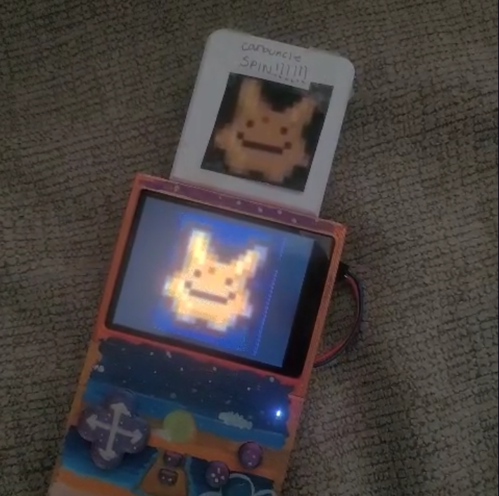
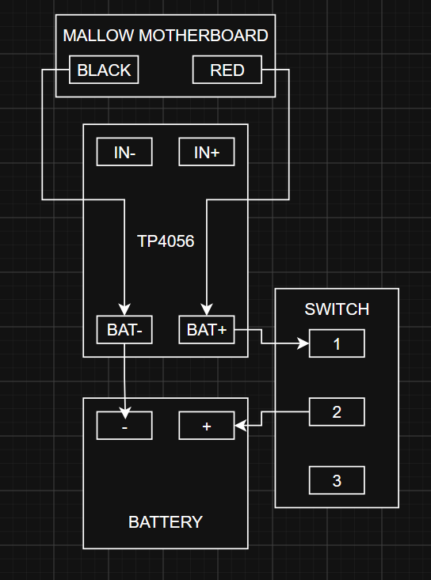
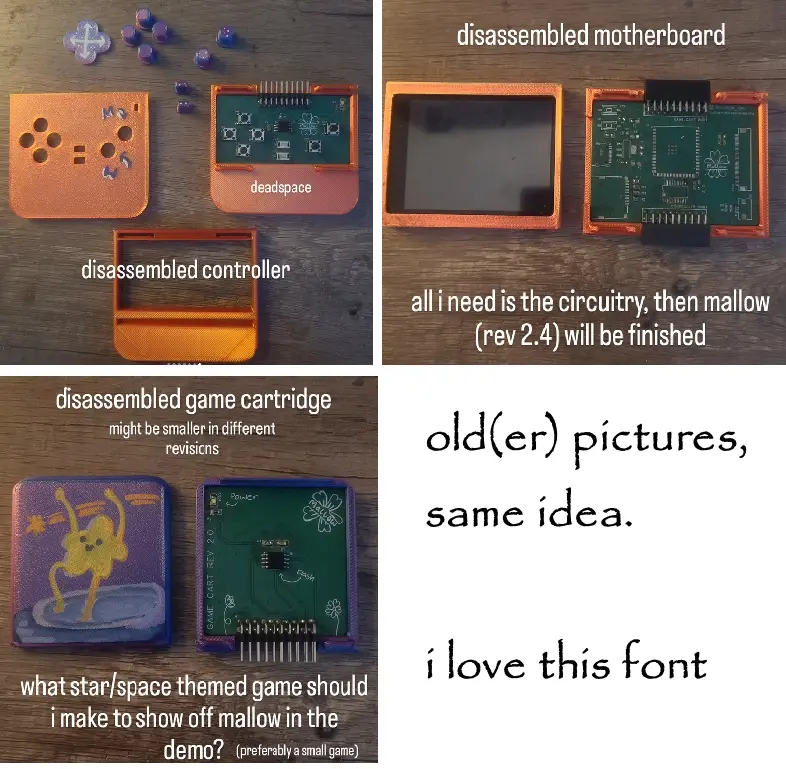
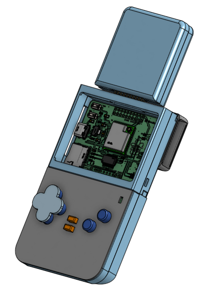

# mallow


mallow is an open source handheld game console that runs off of real cartridges you've designed. mallow isn't an emulator, it's supposed to inspire you to make your own games without having to jump through so many hoops to get it running on real hardware. 

mallow has a detatchable controller, leaving you open to customizing your own controllers with a custom button layout. if you wanted to get more advanced, add a sensor! since it's open source, you can edit the source code to do so. 



## current features/components
- detatchable controllers for easier storage and, in the future, data transfer between Mallow devices
- a 320x240 resolution 2.8" display.
- reads and plays your custom game cartridges

## so you want to build mallow yourself!
### dependencies 
you'll need...
- the esp-idf and its dependencies ([Windows](https://docs.espressif.com/projects/esp-idf/en/stable/esp32/get-started/windows-setup.html), [Linux](https://docs.espressif.com/projects/esp-idf/en/stable/esp32/get-started/linux-setup.html), and [Mac](https://docs.espressif.com/projects/esp-idf/en/stable/esp32/get-started/macos-setup.html))
- all the components in bom.csv unless stated otherwise

### hardware check!
make sure you have everything installed onto the main board correctly, we wouldn't want any shorts. to run it off of battery, after you're done flashing the program, check out the external wiring guide below. 

#### power pak / power supply (external wiring)


got all of your 3D printed parts? assembly guide is here: https://www.youtube.com/watch?v=m0DVB6CYGms

*if you don't have your parts, find them in cad/STEP or cad/STL*


### setting up firmware
- download everything from firmware/FINAL.
- create a new ESP-IDF project called mallow_rev2 (`idf.py create-project mallow_rev2`). if it's not named this, you'll have to change line 6 of your /FINAL/`CMakeLists.txt` file to match the name (`project(mallow_rev2)`). please note that the ESP-IDF runs off of two `CMakeLists.txt` files: one in the root of your project folder and one inside `main`. 
- replace any duplicate files you see on your system and that you downloaded from here, mainly `main/mallow_rev2.c` and `main/CMakeLists.txt`. move `warning.h` into `main` as well.
- after you've done that, move all of your draw functions into a folder called `draw_functions` and place that folder in `main` as well. 
- move all Lua files out of `/lua` and into your `/main` directory with your `mallow_rev2.c` file.
  
by now you should have all of your source files, and you should have a directory tree that looks like this: 
```
mallow_rev2/
├── CMakeLists.txt
└── main/
    ├── draw_functions/
    │   ├── draw_functions.c
    │   └── draw_functions.h
    ├── CMakeLists.txt
    ├── mallow_rev2.c
    ├── lapi.c
    ├── lapi.h
    ├── lauxlib.c
    ├── lauxlib.h
    ├── lbaselib.c
    ├── lcode.c
    ├── lcode.h
    ├── lcorolib.c
    ├── lctype.c
    ├── lctype.h
    ├── ldblib.c
    ├── ldebug.c
    ├── ldebug.h
    ├── ldo.c
    ├── ldo.h
    ├── ldump.c
    ├── lfunc.c
    ├── lfunc.h
    ├── lgc.c
    ├── lgc.h
    ├── linit.c
    ├── liolib.c
    ├── ljumptab.h
    ├── llex.c
    ├── llex.h
    ├── llimits.h
    ├── lmathlib.c
    ├── lmem.c
    ├── lmem.h
    ├── loadlib.c
    ├── lobject.c
    ├── lobject.h
    ├── lopcodes.c
    ├── lopcodes.h
    ├── lopnames.h
    ├── loslib.c
    ├── lparser.c
    ├── lparser.h
    ├── lprefix.h
    ├── lstate.c
    ├── lstate.h
    ├── lstring.c
    ├── lstring.h
    ├── lstrlib.c
    ├── ltable.c
    ├── ltable.h
    ├── ltablib.c
    ├── ltm.c
    ├── ltm.h
    ├── lua.h
    ├── lua.hpp
    ├── luaconf.h
    ├── lualib.h
    ├── lundump.c
    ├── lundump.h
    ├── lutf8lib.c
    ├── lvm.c
    ├── lvm.h
    ├── lzio.c
    ├── lzio.h
    └── warning.h
```
*i used https://tree.nathanfriend.com for the tree diagram. yes, i could have used the command line, but it wouldn't paste correctly here :(*

now it's time to configure the ESP-IDF! plug in mallow through the USB-C port, open the command line, cd into your project directory, then...
- `idf.py set-target esp32s3` (configures the program to be compiled onto an esp32-s3, what mallow uses.)
- `idf.py flash monitor` (flashes the program onto the esp32-s3 and monitors it through the serial monitor. think of it like pressing Compile on the Arduino IDE and opening the serial monitor.)

if that doesn't return any errors, then you're set! you should get a no cartridge inserted screen. 

if you think you're ready to make your own cartridge, i have a guide on how to do that in [firmware/cartridge_programmer](https://github.com/twentyfivefishinthetoilet/mallow/tree/main/firmware/cartridge_programmer). there's a BOM, a wiring diagram for hooking up your cartridges, and more. in order to get that running, you'll basically have to do this whole thing all over again, but with cartridge_programmer (create project, set target, flash monitor: it should be easier now that you know what to do). it's not an intensive guide on how to program your own game yet, so i encourage you to look at the `stub_functions` and `draw_functions.c` to... well, figure it out yourself. sorry, i'll make a guide about that soon. 

## gallery 

### pcb
**main board**


**controller**


**cartridge**


*find my project file in the `pcb` directory!*

**misc**


digital final assembly
<br>

